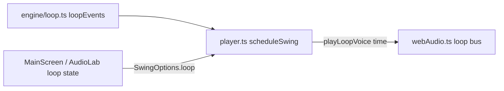

# Design: background-loop

Follows `.kiro/specs/audio-playback/design.md` (adapter, lookahead scheduling) and `app-shell-ui/design.md` (shared Switch). Not restated.

## Working assumptions (tuned by ear later, all named constants)

- One bar = one swing cycle, so the loop repeats exactly with the swing, including the silent repeat pause. Tour Tempo does the same (3.0 s at 30/10).
- The pattern is Tour Tempo's, measured from its clips (see `docs/development-decisions.md`, section 2): 12 steps per bar, kick 0/4/8, snare 2/6/10, hat on every step with accents on 0/2/6/10, ghost kicks 1/5/9 only on the presets listed in `GHOST_KICK_PRESETS` (18/6 and Short 14/7, 16/8). The list replaced a 0.17 s step threshold that sat only 1.2 ms from 16/8 (audit, November 2026).
- Fast Long Game presets (beat 1 to beat 2 at most `ANCHOR_MIN_BEAT2_SECONDS.long` = 1.0 s, so 18/6 to 30/10) use an even cycle/12 grid, as Tour Tempo does. Forcing beats onto steps there made the beat 2 to beat 3 part of the loop sound slower (33% at 18/6), found by ear.
- Short Game is always anchored (`ANCHOR_MIN_BEAT2_SECONDS.short` = 0), with beat 2 on step 3 and beat 3 on step 6 (`ANCHOR_STEPS.short`). On the even grid its beat 2 landed 0.13 to 0.17 s before the kick on step 4, heard as a double hit (audit, November 2026). Cost: the middle steps (beat 2 to beat 3) are 5% (14/7) to 23% (24/12) shorter than the rest. To be checked by ear.
- Slower Long presets use three even sections so beat 2 is exactly step 4 and beat 3 exactly step 6. A plain cycle/12 grid put beat 3 up to 0.37 s off the loop at 168/56 because beat 3 includes a fixed 0.2 s delay.
- A step longer than 0.5 s gets extra soft hat ticks (`HAT_MAX_GAP_SECONDS`), with a small rounding slack so a step of exactly 0.5 s (60/20) is not split in two. On anchored grids with subdivided steps (Long 84/28 and slower), beat 2 to beat 3 is ticked as one span, with the tick count closest to the gap elsewhere; this keeps the pulse within about 13% instead of speeding up by as much as 26%, and lets that span's gap run slightly over 0.5 s (0.52 s at 168/56). Kick and snare are not thinned at slow tempos.
- Everything is data in `loop.ts` (`KICK_STEPS`, `SNARE_STEPS`, `HAT_ACCENT_STEPS`, `GHOST_KICK_STEPS`, `GHOST_KICK_PRESETS`, `ANCHOR_STEPS`, `ANCHOR_MIN_BEAT2_SECONDS`).
- Sounds (web adapter, synthesized): kick = sine sweep 150 to 45 Hz, decay about 0.35 s. Snare = bandpassed noise burst plus a short 180 Hz tone, about 0.2 s. Closed hat = high-passed noise, about 0.05 s. One shared noise buffer. Levels are named constants. Loop bus gain about 0.5 of the beeps, and it must never mask them.

## Components

- `src/engine/loop.ts` (+ `loop.test.ts`, export from `index.ts`): `loopEvents(preset, options?)`, `LoopEvent`, constants. `options` can override `hatMaxGapSeconds` for tests and tuning. Pure, no audio imports.
- `src/audio/types.ts`: `LoopVoice = 'kick' | 'snare' | 'hat'`. `Voice` stays for beeps. `AudioAdapter` gets an optional `playLoopVoice?(voice: LoopVoice, time: number, accent?: boolean)` so other adapters and fakes keep compiling.
- `src/audio/webAudio.ts`: loop voices connect to a loop bus gain, then to the destination. Loop voices are tracked with the same fader and fade-out as beeps, so `stopAll()` silences scheduled ones.
- `src/audio/player.ts`: `SwingOptions.loop?: boolean` (default false). `scheduleSwing` also schedules `loopEvents(preset)` at `startTime + time`. `ScheduledSwing.loop` exposes the scheduled events for checks.
- `usePlayerSession` and `MainScreen`: loop state is plain `useState` in `MainScreen`, off by default, passed into `swingOptionsFor`. Changing it calls `player.change()` like a preset change. The Audio lab has its own Loop option.

## Error handling

If an adapter has no `playLoopVoice`, loop events are skipped silently. The loop never changes beep timing: beeps are scheduled first and loop events only add sound.

## Testing

- Engine: automated tests in `loop.test.ts` (R1). No property-based library, because the input space is the 16 presets, which a loop over `PRESETS` covers fully.
- Audio and UI: manual listening checks, listed per task.
