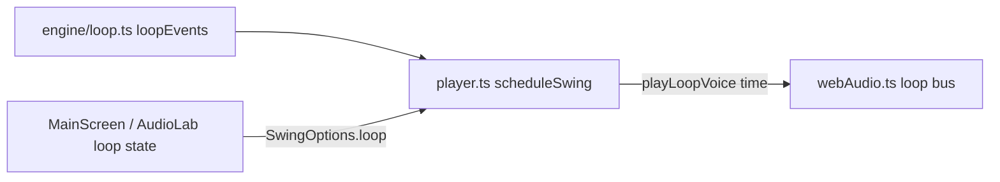

# Design: background-loop

Follows `.kiro/specs/audio-playback/design.md` (adapter, lookahead scheduling) and `app-shell-ui/design.md` (shared Switch). Not restated.

## Working assumptions (tuned by ear later, all named constants)

- One bar = one swing cycle, so the loop repeats exactly with the swing, including the silent repeat pause. Tour Tempo does the same (3.0 s at 30/10).
- Bar split into 4 quarters (`cycle / 4`).
- Pattern table (data, in `src/engine/loop.ts`):

| Table | Kick quarters | Snare quarters |
|---|---|---|
| `NORMAL_PATTERN` | 1, 3 | 2, 4 |
| `SLOW_PATTERN` (quarter > `SLOW_QUARTER_SECONDS` = 2.5) | 1 | 3 |

- Hat: `k = max(1, ceil(quarter / HAT_MAX_GAP_SECONDS))` ticks per quarter, `HAT_MAX_GAP_SECONDS = 0.5`, evenly spaced, first tick on the quarter start, `accent: true` on that first tick.
- Examples: 30/10 cycle 3.0 s, quarter 0.75 s, 2 ticks per quarter. 168/56 cycle about 16 s, quarter about 4 s, 9 ticks per quarter, slow table (kick and snare once each, hat carries the pulse). 84/28 (quarter about 2.0 s) now stays on the normal table, clear of the 2.5 s switch point; check it by ear. Decided: the loop keeps playing through the silent repeat pause.
- Sounds (web adapter, synthesized): kick = sine sweep 150 to 45 Hz, decay about 0.35 s. Snare = bandpassed noise burst plus a short 180 Hz tone, about 0.2 s. Closed hat = high-passed noise, about 0.05 s. One shared noise buffer. Levels are named constants. Loop bus gain about 0.5 of the beeps, and it must never mask them.

## Components

- `src/engine/loop.ts` (+ `loop.test.ts`, export from `index.ts`): `loopEvents(preset, options?)`, `LoopEvent`, constants. `options` can override `hatMaxGapSeconds` and `slowQuarterSeconds` for tests and tuning. Pure, no audio imports.
- `src/audio/types.ts`: `LoopVoice = 'kick' | 'snare' | 'hat'`. `Voice` stays for beeps. `AudioAdapter` gets an optional `playLoopVoice?(voice: LoopVoice, time: number, accent?: boolean)` so other adapters and fakes keep compiling.
- `src/audio/webAudio.ts`: loop voices connect to a loop bus gain, then to the destination. Loop voices are tracked with the same fader and fade-out as beeps, so `stopAll()` silences scheduled ones.
- `src/audio/player.ts`: `SwingOptions.loop?: boolean` (default false). `scheduleSwing` also schedules `loopEvents(preset)` at `startTime + time`. `ScheduledSwing.loop` exposes the scheduled events for checks.
- `usePlayerSession` and `MainScreen`: loop state is plain `useState` in `MainScreen`, off by default, passed into `swingOptionsFor`. Changing it calls `player.change()` like a preset change. The Audio lab has its own Loop option.

## Error handling

If an adapter has no `playLoopVoice`, loop events are skipped silently. The loop never changes beep timing: beeps are scheduled first and loop events only add sound.

## Testing

- Engine: automated tests in `loop.test.ts` (R1). No property-based library, because the input space is the 16 presets, which a loop over `PRESETS` covers fully.
- Audio and UI: manual listening checks, listed per task.
