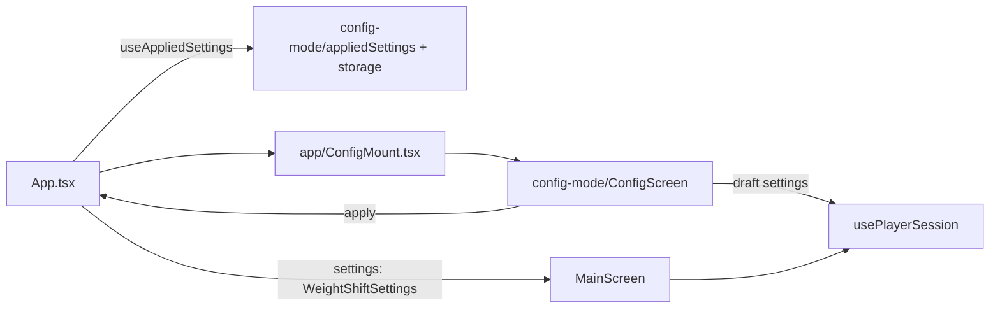

# Design: config-mode

Follows `audio-playback/design.md` (Player, `change()` debounce), `app-shell-ui/design.md` (theme, shared components) and `background-loop/design.md`. Not restated.

## How the current code works (read before designing)

- `swingOptionsFor` in `src/ui/hooks/usePlayerSession.ts` and the `BeatTimeline` in `MainScreen.tsx` both use `defaultWeightShiftSettings()`. Normal mode ignores saved values today, so wiring them in is a real change (Wave 5.2) and touches what you hear.
- `usePlayerSession` restarts on a change of preset or loop, and its comment says to call it only from `MainScreen`, because `MainScreen` stays mounted (hidden) under other screens. A second instance would restart twice. The hidden `MainScreen` also still reacts to the shared Player's state.
- `ConfigPlaceholder` is mounted from `App.tsx` by `screen === 'config'`. The Audio lab uses a mount file, `AudioLabMount.tsx`, which is the pattern to copy.
- There is no slider, no generic button and no dialog component. `Menu.tsx` has an internal `Overlay` (Modal, backdrop, Escape on web, Android back) that the app-shell design said a confirm dialog would reuse.
- `BeatTimeline` already takes `weightShiftPosition` and recomputes from it, so a live marker needs no new timeline code. `restartKey` handles the loop switch.

## Structure

- `src/config-mode/appliedSettings.ts` (pure): `parseApplied(raw)`, `serializeApplied(...)`, `mergeApplied(raw, category, value)`, types. Tested.
- `src/config-mode/appliedStorage.ts`: `loadApplied()` and `saveApplied(category, value)` over `src/storage/` getItem/setItem. Never throw. Key `golf-tempo:weight-shift:v1`, value `{"version":1,"long":0.53,"short":0.6}`. A missing category key means "never applied".
- `src/config-mode/exportText.ts` (pure): `buildExportText(applied, now, device?)`. Tested. Shape: `{ configVersion: 1, exportedAt, device?, longGame: { weightShiftPosition, applied }, shortGame: { ... } }`.
- `src/config-mode/useAppliedSettings.ts`: React hook. State `{ loaded, settings: WeightShiftSettings, applied: Record<Category, boolean> }` and `apply(category, value)`. Updates state first, then writes to storage, so a failed write keeps the value for the session (R1.5).
- `src/config-mode/ConfigScreen.tsx`: the screen. Local state: category, preset index per category (start from main's), Draft_Values, committed values (see Slider and playback), loop, export text, leave dialog.
- `src/app/ConfigMount.tsx`: the one mount point. Re-exports `useAppliedSettings` and renders `ConfigScreen`. Replaces `ConfigPlaceholder.tsx`, which is deleted. `App.tsx` calls `useAppliedSettings()` once, holds the result, passes `settings` to `MainScreen` and the whole object to `ConfigMount`.

`App.tsx` adds "applied loaded" to the intro's load gate (R1.7). A failed load counts as done with defaults.

## Data flow for the normal screen

`MainScreen` takes a `weightShiftSettings: WeightShiftSettings` prop. It passes it to `usePlayerSession({ preset, loop, settings })` and to `BeatTimeline` (`settings[category]`). `swingOptionsFor` uses `settings` instead of the defaults. `MainScreen` and the hook import nothing from `src/config-mode/`.

## One run, one owner

To keep main and config from both reacting (R5.5):

- `usePlayerSession(selection, { active })`. Default `active = true`. When `active` is false the hook neither restarts on change nor starts playback, and it resets its "last selection" memory so that becoming active again does not trigger a restart.
- `MainScreen` gets `active` from `App` (true only while the main screen is showing).
- `ConfigScreen` is mounted only while open, calls the hook with its own selection and draft settings, and so owns the run while it exists.
- Entering Config stops the shared player (as the lab does). Leaving stops it.
- APPLY changes `settings` for the main screen (inactive, so no restart) and leaves the Config run alone, because the Draft_Value that is playing already equals the new Applied_Value.

The hook's "only from MainScreen" comment is updated to say "one active instance at a time".

## Slider and playback

State in `ConfigScreen`: `drafts: Record<Category, number>` (what the slider shows, updated on every move) and `committed: Record<Category, number>` (what the Player uses, updated on release). Both start at the Applied_Value. The hook gets `committed` as `settings`, so the restart fires on release only (R5.2). Keyboard, screen reader, nudge and reset set both at once.

`Slider` (new shared component, `src/ui/components/Slider.tsx`): `value`, `min`, `max`, `step`, `onChange` (every move), `onChangeEnd` (release), `accessibilityLabel`, `valueText`. Built from `View` and `PanResponder`, no dependency (tech.md: few dependencies, React Native primitives). Track and thumb from theme tokens; thumb touch area at least `tapMin`. Web gets `role="slider"`, `aria-valuenow`, `aria-valuetext` and arrow, Home and End keys through a guarded `onKeyDown`; native gets `accessibilityRole="adjustable"` and `accessibilityActions` (increment, decrement). Focus ring via `useFocusRing`.

Open decision: nudge buttons (minus and plus, one step). On a 320 pt wide phone the track is about 270 pt for 0.90, so one pt is about 0.003. A finger cannot reliably hit one 0.01 step. Recommend including them (two icons, `minus` and `plus`, and the existing `IconButton`). Say no and R4.5 is dropped.

## Readout

"Weight shift 53 %" and "0.53 s after takeaway" (position times `beat2Time(preset)`), using engine functions, so it changes with the preset. Shown in the normal text colors (`AppText`, or an existing `Badge` variant if the Reuse check finds one that fits). No gold: the weight shift diamond is white, so the readout must not suggest a gold weight shift. Gold stays only on the timeline's progress fill. Under it: "Saved: 50 %" or "Saved: default (50 %)", and "Not applied yet" when Unapplied.

## Components (Reuse check preview, repeated in each UI task)

| Need | Plan |
|---|---|
| Category control | reuse `SegmentedControl` |
| Preset grid | reuse `PresetGrid`, `PresetButton`, `presetLabel` |
| Timeline | reuse `BeatTimeline` with the draft position |
| Play button | reuse `PlayButton` |
| Loop switch | reuse `Switch` |
| Section labels, card, text, status | reuse `SectionLabel`, `Card`, `AppText`, `StatusMessage`, `Badge` |
| Back control | reuse `IconButton` (icon `back`), as the placeholder does |
| Slider | new, `Slider` |
| APPLY, Reset, EXPORT, Copy, dialog Yes/No | new generic `Button` (primary, secondary, disabled). `PresetButton` has selection semantics that do not fit. Reuse check confirms before building. |
| Dialog | new `ConfirmDialog`, built on the existing overlay: `Overlay` is extracted from `Menu.tsx` into its own file and exported for both |
| Nudge icons | extend `Icon` with `minus` and `plus` (only if nudge buttons are in) |

New theme tokens only if the check shows a value missing (slider track height, thumb size).

## Export delivery

Same pattern as the Audio lab's Copy log: try `navigator.clipboard.writeText` on web, otherwise show the text selectable with a hint. The lab's code stays where it is; the export builds its own small guarded copy function in `src/config-mode/` (the lab is a separate temporary module and must not depend on config-mode or the reverse). `device` is read with the same `typeof navigator` guard.

## Safe range

The slider uses the engine's `WEIGHT_SHIFT_RANGE` (0.05 to 0.95). That settles `dev_questions.md` item 5 for now: at 18/6 a 5 % position is about 0.03 s after takeaway, a flam. The brother may find ends unusable; narrowing the range is an engine constant change, not a CONFIG change. Loaded values are validated against the same range, so a value saved under a narrower future range falls back to default.

## Loop while calibrating

Off by default each time Config opens, switch in the screen. The weight shift never sits on the drum grid; at some tempos it lands within tens of ms of a snare or hat (found at 0.53 on fast Long presets, see `dev_questions.md`). The calibration guide tells the brother to try both and say which he used.

## Removal in spec 6 (R9.2)

Delete `src/config-mode/`, `src/app/ConfigMount.tsx`; in `App.tsx` replace `useAppliedSettings()` with the hard-coded settings and drop the Config screen state and load gate; in `MainScreen.tsx` remove the Config menu item and `onOpenConfig`; delete the saved key (needs a `removeItem` in `src/storage/`, added in spec 6). The shared `Slider`, `Button`, `ConfirmDialog` stay or go as that spec decides. `usePlayerSession`'s `settings` and `active` options stay.

## Error handling

Storage failures never show an error (R1.5). Clipboard failure shows the manual-copy hint. Slider values are clamped with `clampPosition` before use.

## Testing

- Automated (small, pure, data safety): `appliedSettings.test.ts` and `exportText.test.ts`. This needs `src/config-mode/**/*.test.ts` added to `vitest.config.mts`, which is not covered today. Open decision, because `tech.md` says non-engine code is checked manually unless you ask. Recommended, since a bad parse could silently change the brother's calibrated values. The tests are deleted with the module in spec 6.
- Everything else manual, listed per task. Playback checks need listening on desktop, then Pixel 6 and iPad.
